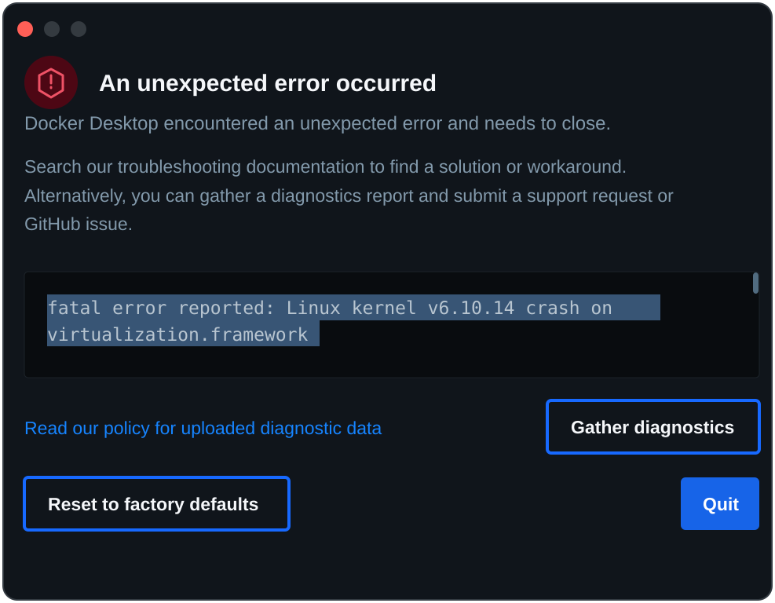

# QEMU Device Tree Lab

**Goal:** Build a disposable ARM64 Linux development environment on a MacBook M2 using Docker and QEMU. Learn to inspect, modify, validate, and debug Linux Device Trees before applying the knowledge to the KR260 / SMK-K26 platform.

**Inspiration:** [This ChatGPT conversation](https://chatgpt.com/c/6aed5f48-9e48-83ec-a5a1-912a1e9a64c7).

**Estimated effort:** 12–16 hours  
**Suggested duration:** 2–3 weeks  
**Project directory:** `~/Projects/devicetree-lab`

## Progress Tracker

- [X] Phase 1: Set up Docker environment (1–2 hours)
- [ ] Phase 2: Boot an ARM64 Linux guest (2–3 hours)
- [ ] Phase 3: Understand the Device Tree (2 hours)
- [ ] Phase 4: Modify and validate the DTB (2–3 hours)
- [ ] Phase 5: Explore Linux driver binding (3–4 hours)
- [ ] Phase 6: Apply the concepts to KR260 (2 hours)

---

## Phase 1 — Set up Docker environment

**Estimated effort: 1–2 hours**

- [X] Create project directory structure:
  - `docker/`
  - `buildroot/`
  - `dts/`
  - `scripts/`
  - `notes/`
- [X] Write a Dockerfile using an ARM64 Linux base image.
- [X] Install development tools:
  - GCC / build tools
  - Git
  - Make
  - QEMU system emulator
  - Device Tree Compiler (`dtc`)
  - Useful inspection tools
- [X] Build and test the Docker image.
- [X] Verify tool versions:
  - [X] `uname -m`
  - [X] `qemu-system-aarch64 --version`
  - [X] `dtc --version`
- [X] Configure persistent volume mounting for the project directory.

**Container environment snapshot:**

| Check | Result |
| --- | --- |
| `uname -m` | `aarch64` |
| Buildroot `git log -1 --oneline` | `b21d9e74` — `DEVELOPERS: add Angelo Compagnucci for imagemagick` |
| `qemu-system-aarch64 --version` | QEMU emulator version 8.2.2 (Debian 1:8.2.2+ds-0ubuntu1.18) |
| `dtc --version` | Version: DTC 1.7.0 |
| `gcc --version` | gcc (Ubuntu 13.3.0-6ubuntu2~24.04.1) 13.3.0 |
| `python3 --version` | Python 3.12.3 |

**Milestone:** A reproducible ARM64 development environment is available through Docker.

## Phase 2 — Boot an ARM64 Linux guest

**Estimated effort: 2–3 hours**

Use the root `Makefile` to build and run the Docker environment:

```bash
make docker-build
make docker-run
```

`docker-run` starts an interactive container. To build the QEMU image in a temporary container instead, run `make qemu-image`; this builds the Docker image first if needed, then runs `/workspace/scripts/build_qemu_image.sh`. Run `make all` to perform the Docker and QEMU image builds in sequence.

If Docker Desktop exits with the error below while running the build script, its Linux VM kernel has crashed in macOS `virtualization.framework`. This is a Docker Desktop virtualization failure, not a Buildroot configuration or QEMU guest error. The scripts save their combined output in timestamped log files under `build/` for troubleshooting.



- [X] Clone Buildroot.
- [X] Configure `qemu_aarch64_virt_defconfig`.
- [X] Build the Linux kernel.
- [X] Build the root filesystem.
- [ ] Generate the initial Device Tree Blob (DTB).
- [ ] Create a QEMU launch script.
- [ ] Boot ARM64 Linux using QEMU's `virt` machine.
- [ ] Use TCG software emulation (KVM is generally unavailable through Docker Desktop on macOS).
- [ ] Log in to the guest Linux system.
- [ ] Verify:
  - [ ] `uname -a`
  - [ ] `/proc/cpuinfo`
  - [ ] `/proc/device-tree`

**Milestone:** A working ARM64 Linux system boots inside QEMU.

## Phase 3 — Understand the Device Tree

**Estimated effort: 2 hours**

- [ ] Dump the live Device Tree from `/sys/firmware/devicetree/base`.
- [ ] Convert the Device Tree into readable DTS format using `dtc`.
- [ ] Explore important nodes:
  - [ ] `/cpus`
  - [ ] `/memory`
  - [ ] `/chosen`
  - [ ] `/soc`
  - [ ] Serial controller
  - [ ] Interrupt controller
- [ ] Understand Device Tree properties:
  - [ ] `compatible`
  - [ ] `reg`
  - [ ] `status`
  - [ ] `interrupts`
  - [ ] `clocks`
- [ ] Understand address translation:
  - [ ] `#address-cells`
  - [ ] `#size-cells`
  - [ ] `ranges`
- [ ] Trace an interrupt property to its interrupt controller.

**Milestone:** Understand the structure and meaning of a real Linux Device Tree.

## Phase 4 — Modify and validate the DTB

**Estimated effort: 2–3 hours**

- [ ] Extract the original DTS from the QEMU-generated DTB.
- [ ] Create a custom DTS source file.
- [ ] Add a simple custom Device Tree node.
- [ ] Add a `compatible` string and several properties.
- [ ] Compile the DTS into a DTB using `dtc`.
- [ ] Inspect the generated DTB.
- [ ] Configure QEMU to boot with the custom DTB.
- [ ] Verify that the custom node appears in the guest.
- [ ] Introduce a deliberate DTS syntax or property error.
- [ ] Observe the resulting failure.
- [ ] Fix the error and boot successfully again.

**Milestone:** Successfully modify a Device Tree and boot Linux using the modified DTB.

## Phase 5 — Explore Linux Device and Driver Binding

**Estimated effort: 3–4 hours**

- [ ] Explore `/sys/bus/platform/devices`.
- [ ] Identify platform devices created from Device Tree.
- [ ] Find a device's `compatible` property.
- [ ] Locate the corresponding Linux driver match table.
- [ ] Check relevant kernel configuration options.
- [ ] Write a simple Linux platform driver.
- [ ] Add a matching compatible string.
- [ ] Implement basic `probe()` and `remove()` callbacks.
- [ ] Build the driver as a kernel module.
- [ ] Load the module.
- [ ] Observe the probe message in kernel logs.
- [ ] Inspect the driver symlink in sysfs.
- [ ] Unload the module and observe the remove callback.

**Milestone:** Understand how Linux discovers a Device Tree device and binds it to a platform driver.

## Phase 6 — Apply the Concepts to KR260 / SMK-K26

**Estimated effort: 2 hours**

- [ ] Decompile the working KR260 `system.dtb`.
- [ ] Inspect the board-specific Device Tree structure.
- [ ] Compare QEMU and KR260 Device Tree nodes:
  - [ ] CPU
  - [ ] Memory
  - [ ] `chosen`
  - [ ] SoC
  - [ ] Interrupt controllers
  - [ ] Clocks
- [ ] Select one real KR260 peripheral (Ethernet, USB, or NVMe).
- [ ] Trace its Device Tree node.
- [ ] Identify its `compatible` string.
- [ ] Identify its register address and interrupt resources.
- [ ] Locate the corresponding Linux driver.
- [ ] Document the path from DTS source to DTB, bootloader handoff, Linux device creation, and driver probe.

**Milestone:** Connect the QEMU experiments to the actual KR260 Linux platform.

---

## Definition of Done

The lab is complete when I can:

- [ ] Start an ARM64 Linux guest with a single command.
- [ ] Extract and read its live Device Tree.
- [ ] Understand the structure of common Device Tree nodes.
- [ ] Modify a DTS file and compile a DTB.
- [ ] Boot Linux using the modified DTB.
- [ ] Explain how a Device Tree node becomes a Linux platform device.
- [ ] Demonstrate driver matching and binding.
- [ ] Apply the same debugging approach to a KR260 peripheral.

## Suggested Schedule

| Week | Focus | Target |
|---|---|---|
| Week 1 | Docker, QEMU, Device Tree basics | Boot Linux and inspect its DTB |
| Week 2 | DTS modifications and validation | Boot with a custom DTB |
| Week 3 | Driver binding and KR260 | Complete one peripheral investigation |

## Learning Notes

Use this section to record useful discoveries, commands, and debugging lessons.

### Key findings

- 

### Useful commands

```bash
# Add frequently used commands here
```

### Problems encountered

- 

### Ideas for further experiments

- 

---

**Guiding principle:** Learn a little, experiment a little. Keep each session small and practical. The objective is not to build a complete embedded Linux distribution, but to become confident experimenting with Device Trees in a safe environment.